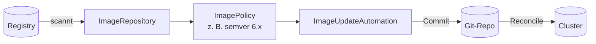

# Image Automation

!!! info "Referenz – noch nicht selbst im Einsatz"
    Ich halte Versionen bisher mit [Renovate](../renovate.md) aktuell. Diese Seite fasst zusammen, wie Flux das selbst kann, damit ich es bei Bedarf schnell aufsetzen kann.

**Wofür?** Flux erkennt neue Image-Tags in einer Registry und schreibt den neuen Tag per Commit zurück ins Git-Repo. Typischer Einsatz: eigene Apps, deren CI bei jedem Build ein neues Image pusht.



## Voraussetzung

Die beiden Image-Controller sind **nicht** im Standard-Bootstrap enthalten, und Flux braucht Schreibrechte aufs Repo:

```bash
flux bootstrap github \
  --owner=<user> --repository=<repo> --path=clusters/my-cluster --personal \
  --components-extra=image-reflector-controller,image-automation-controller \
  --read-write-key
```

## Die drei Objekte

```yaml title="snippets/flux/image-automation.yaml"
--8<-- "snippets/flux/image-automation.yaml"
```

## Marker im Manifest

Flux ändert nur Zeilen mit einem `$imagepolicy`-Kommentar:

```yaml title="snippets/flux/image-automation-deployment.yaml"
--8<-- "snippets/flux/image-automation-deployment.yaml"
```

| Marker | Ersetzt |
|---|---|
| `# {"$imagepolicy": "flux-system:podinfo"}` | `image:tag` komplett |
| `# {"$imagepolicy": "flux-system:podinfo:tag"}` | nur den Tag (z. B. in Helm-Values `tag: 6.7.0`) |
| `# {"$imagepolicy": "flux-system:podinfo:name"}` | nur den Image-Namen |

## Policy-Varianten

=== "SemVer"

    ```yaml
    policy:
      semver:
        range: ">=1.0.0"
    ```

=== "Build-Nummer / Timestamp"

    Für Tags wie `main-abc1234-1718000000`:

    ```yaml
    filterTags:
      pattern: '^main-[a-f0-9]+-(?P<ts>[0-9]+)'
      extract: '$ts'
    policy:
      numerical:
        order: asc
    ```

=== "Alphabetisch"

    ```yaml
    policy:
      alphabetical:
        order: asc
    ```

## Quick commands

```bash
flux get image repository -A          # Scan-Status, letzte Tags
flux get image policy -A              # Welcher Tag wurde gewählt?
flux get image update -A              # Letzter Commit der Automation
flux reconcile image repository podinfo -n flux-system
```

## Flux Image Automation vs. Renovate

| | Flux Image Automation | Renovate |
|---|---|---|
| Läuft | im Cluster | als GitHub App / CI-Job |
| Updates | Container-Images | Images, Helm-Charts, Flux-Komponenten, Go/npm/Terraform, … |
| Ergebnis | direkter Commit (oder Branch) | Pull Request, optional Automerge |
| Review | nur wenn auf Branch gepusht wird | standardmäßig per PR |
| Gut für | eigene Apps mit vielen Builds (z. B. `main`-Tags) | alles andere, versionierte Releases |

**Mein Fazit:** Für Drittanbieter-Charts und -Images reicht Renovate mit Automerge für Minor/Patch. Image Automation lohnt sich, sobald eigene Apps per CI laufend neue Images bauen und ohne PR ausgerollt werden sollen.

## Gotchas

- **Kein Marker, kein Update** – die häufigste Ursache, wenn `ImagePolicy` den richtigen Tag zeigt, aber nichts committet wird.
- `update.path` begrenzt, welche Dateien Flux anfasst – möglichst eng setzen.
- Bei Push auf `main` und gleichzeitig Renovate auf denselben Images entstehen doppelte Updates – pro Image nur **einen** Mechanismus nutzen.
- Private Registries: `secretRef` am `ImageRepository` (Secret vom Typ `dockerconfigjson`).

## Quellen

- [Flux: Automate image updates to Git](https://fluxcd.io/flux/guides/image-update/)
- [ImagePolicy API](https://fluxcd.io/flux/components/image/imagepolicies/)
