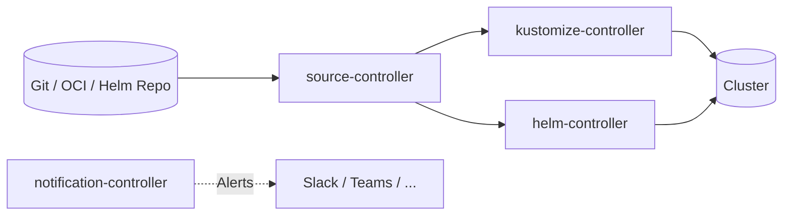

# FluxCD

Flux gleicht den Cluster laufend mit dem Stand in Git (oder OCI/Helm-Repos) ab.



## Quick commands

```bash
flux check                                   # Voraussetzungen & Controller prüfen
flux get all -A                              # Alle Flux-Objekte und ihr Status
flux reconcile kustomization flux-system --with-source   # Sofort syncen
flux suspend kustomization apps              # Reconciliation pausieren
flux resume kustomization apps               # ... und fortsetzen
flux logs --level=error --all-namespaces     # Fehler aus allen Controllern
flux tree kustomization flux-system          # Was verwaltet welche Kustomization?
flux diff kustomization apps --path ./apps/production   # Lokale Änderungen vs. Cluster
```

## Seiten

- [Bootstrap](bootstrap.md)
- [Repo-Layout & Kustomization-Kette](layout.md) – so sind meine Cluster aufgebaut
- [Sources & Kustomizations](kustomization.md)
- [HelmRelease](helmrelease.md) – inkl. Beispiele für cert-manager, Longhorn, kube-prometheus-stack, Cilium
- [Secrets mit SOPS](sops.md)
- [Notifications](notifications.md) – Discord-Alerts
- [Debugging](debugging.md)

## Meine Flux-Cluster

| Cluster | Repo | Inhalt |
|---|---|---|
| Talos auf Hetzner | `d4sw4r/talos-k8s` | Cilium, cert-manager, Longhorn, kube-prometheus-stack, SOPS, Discord-Alerts – [PoC](../../pocs/talos-hetzner.md) |
| AI-Cluster | `d4sw4r/ai-cluster` | llmkube-Operator, Qwen3-Inference – [PoC](../../pocs/llmkube.md) |

## Quellen

- [Flux Dokumentation](https://fluxcd.io/flux/)
- [flux2-kustomize-helm-example](https://github.com/fluxcd/flux2-kustomize-helm-example)
