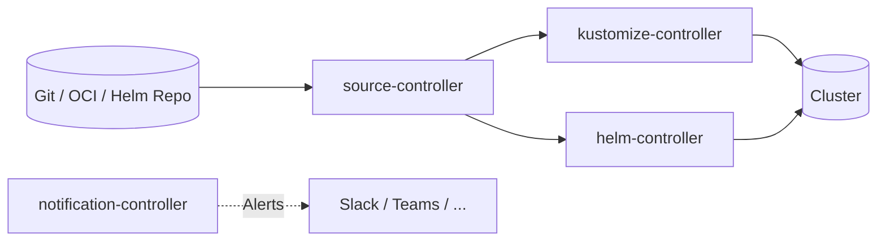

# FluxCD

Flux gleicht den Cluster laufend mit dem Stand in Git (oder OCI/Helm-Repos) ab.



## Quick commands

```bash
flux check                                   # Voraussetzungen & Controller prüfen
flux get all -A                              # Alle Flux-Objekte und ihr Status
flux reconcile kustomization flux-system --with-source   # Sofort syncen
flux suspend kustomization apps              # Reconciliation pausieren
flux resume kustomization apps               # ... und fortsetzen
flux logs --level=error --all-namespaces     # Fehler aus allen Controllern
flux tree kustomization flux-system          # Was verwaltet welche Kustomization?
flux diff kustomization apps --path ./apps/production   # Lokale Änderungen vs. Cluster
```

## Seiten

- [Bootstrap](bootstrap.md)
- [Sources & Kustomizations](kustomization.md)
- [HelmRelease](helmrelease.md)
- [Secrets mit SOPS](sops.md)
- [Debugging](debugging.md)

## Mein Repo-Layout

!!! note "TODO"
    Eigenes Layout dokumentieren. Verbreitet ist:

```
├── clusters/
│   ├── production/      # flux-system + Kustomizations, die auf infra/apps zeigen
│   └── staging/
├── infrastructure/      # Controller, CRDs, Ingress, cert-manager, ...
│   ├── base/
│   └── production/
└── apps/
    ├── base/
    └── production/
```

## Quellen

- [Flux Dokumentation](https://fluxcd.io/flux/)
- [flux2-kustomize-helm-example](https://github.com/fluxcd/flux2-kustomize-helm-example)
