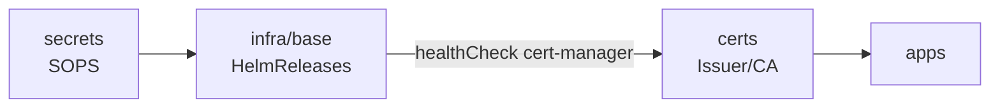

# Repo-Layout & Kustomization-Kette

So ist mein Talos-Cluster (`talos-k8s`) aufgebaut:

```
├── clusters/my-cluster/
│   ├── flux-system/          # von flux bootstrap erzeugt (gotk-components, gotk-sync)
│   ├── includes.yaml         # die Kustomization-Kette unten
│   └── discord-alert.yml     # Notifications
├── secrets/my-cluster/       # SOPS-verschlüsselte Secrets
├── infra/base/               # Cilium, cert-manager, Longhorn, Monitoring (HelmReleases)
├── certs/                    # Issuer / CA (braucht cert-manager-CRDs)
├── apps/my-cluster/          # Workloads, Gateway, Routes
├── talos/                    # Machine-Config-Patch, gerendertes Cilium
├── .sops.yaml
└── renovate.json             # Renovate hält Chart- und Image-Versionen aktuell
```



## Die Kette

```yaml title="snippets/flux/kustomization-chain.yaml"
--8<-- "snippets/flux/kustomization-chain.yaml"
```

## Warum so?

- **`certs` braucht die CRDs von cert-manager.** Ohne `dependsOn` + `healthChecks` schlägt der erste Sync mit `no matches for kind "Issuer"` fehl.
- **`healthChecks`** auf das cert-manager-Deployment: `flux-system-base` wird erst `Ready`, wenn cert-manager läuft – dann startet `certs`.
- **Secrets in eigener Kustomization** mit `decryption`, damit nur dieser Pfad entschlüsselt wird.
- **Alles hängt an `flux-system`** (der GitRepository aus dem Bootstrap) – kein zweites Repo nötig.

## Gotchas / Learnings

- HelmRepositories mit `interval: 1m` erzeugen unnötig Last – `1h` reicht, Renovate kümmert sich um neue Versionen.
- Einen Chart-`version` angeben, sonst zieht Flux bei jedem Reconcile die neueste Version.
